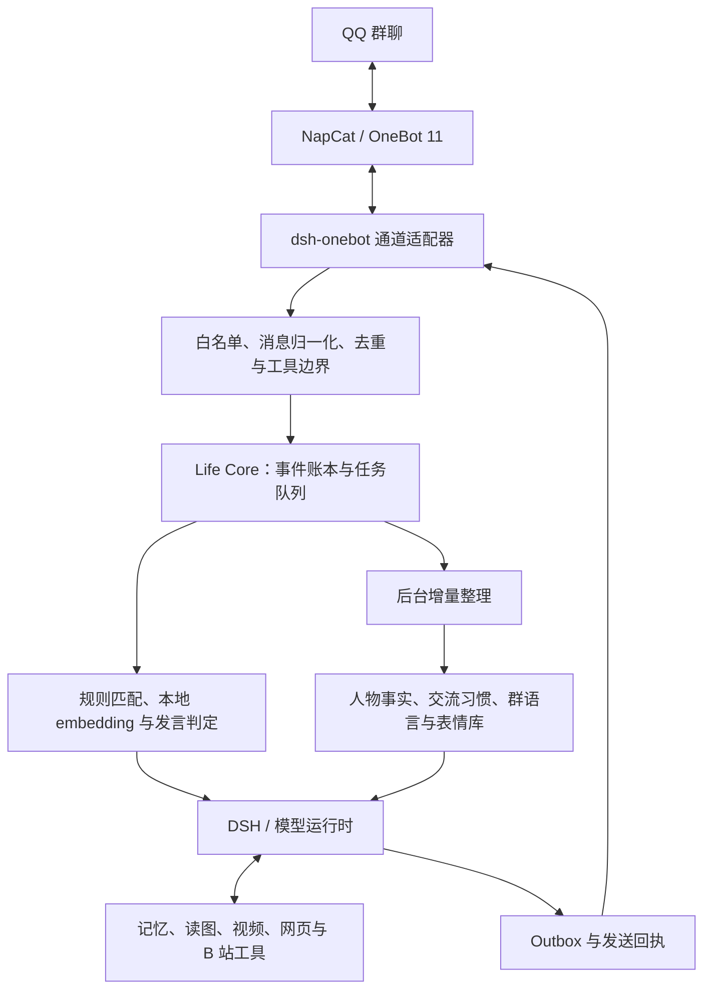

# Bot Life · 数字生命实验归档

**状态：已归档，停止独立开发。** 这里保留了一次从 QQ 群聊机器人走向“独立数字生命”的工程探索，包括需求、架构、源码、数据库迁移、测试与示例部署配置。

> 本着构建一个完整独立数字生命的想法，草草开始了这个项目的开发，没有做好同类型项目的调研，导致大部分时间在重复造轮子。后续或许会在优秀的成熟开源项目maibot之类的基础上进行开发。此项目已归档，仅作为我在项目开发上的一次探索的记录。

后续方向参考 [MaiBot](https://github.com/Mai-with-u/MaiBot)。本仓库不包含 MaiBot 的源码或运行数据。

## 这个项目尝试做什么

以独立 QQ 小号和 NapCat / OneBot 11 为交互通道，以 DeepSeek Harness（DSH）为模型运行时，建立与聊天通道分离的 Life Core：保存经历、整理记忆、识别人物、学习表达，并判断什么时候参与群聊。

“数字生命”在这里是一个工程设想：连续的记忆、可追溯的行为和相对一致的交流习惯；项目没有实现或证明意识、自我觉醒等能力。

## 整体框架



详细数据流、模块入口和存储结构见 [架构说明](docs/ARCHITECTURE.md)。

## 归档时的能力与边界

| 部分 | 已形成的实现 | 主要边界 |
| --- | --- | --- |
| 通道与持久化 | OneBot 收发、会话白名单、事件账本、持久队列、租约、Outbox、恢复与备份 | 无法补回断联期间未收到的消息；API 接受不等于接收端可见 |
| 多媒体 | 直接/引用图片、合并转发展开、QQ 视频抽帧 | 不是连续视频理解；QQ 视频不含音轨识别 |
| 外部内容 | 网页搜索与正文阅读、B 站详情/字幕/短视频抽帧、只读 MCP 桥 | 目标站点、账号权限和字幕可用性会影响结果 |
| 记忆 | PostgreSQL 事实与事件记忆、来源证据、修订、遗忘、按账号识别人物、受限跨群偏好 | 长期记忆以词法检索为主，没有完成完整的向量记忆检索 |
| 学习与反馈 | 后台增量整理、群表达/黑话学习、对话反馈与习惯记忆、表情分类和收藏 | 是结构化记录和上下文注入，不是微调模型权重 |
| 注意力 | 名称/别名匹配、本地中文 ONNX embedding、CPU/CUDA、模型参与发言判定 | embedding 用于注意力召回；无入站消息时的自主话题调度未完成 |
| 管理 | 终端桌面启动器、管理命令、预算与 token 用量记录、隔离的测试和备份恢复 | QQ 风控、票据失效与验证码未实现可靠无人值守恢复 |

完整 Self Model、关系推演、周期性反思、自主目标、语音、Qt6 管理界面及树莓派实机部署未完成。

未完成的群聊监控 WebUI、处理流程可视化和统一交流偏好原型保留在 [`experimental/monitor-unified-persona`](https://github.com/AndyYang12345/bot-life/tree/experimental/monitor-unified-persona) 分支。该分支未部署、未完成端到端验收，与 `main` 的稳定快照区分保存。

## 目录

```text
life-core/          通道无关的领域层、PostgreSQL 迁移与测试
dsh-onebot/        OneBot 接入、DSH 编排、注意力和工具适配
attention_backend/ 本地 ONNX embedding 后端与锁定依赖
bilibili/          B 站只读内容读取、抽帧与 MCP 服务
desktop_app/       终端桌面启动器
deploy/            Compose、服务及配置示例
scripts/           构建检查、初始化、管理、备份与隔离验证
docs/              PRD、架构、历史设计与阶段验收记录
```

- [原始 PRD](docs/PRD.md)：产品设想及演进中的需求。
- [架构说明](docs/ARCHITECTURE.md)：归档版的模块与数据流。
- [归档说明](docs/ARCHIVE-NOTES.md)：快照范围、脱敏方式及验证边界。
- [历史路线图](docs/ROADMAP.md)：停止开发前的计划，保留作记录。

## 阅读、构建与历史运行方式

历史开发环境为 Node.js 24、pnpm 12、Python 3、Docker Compose、PostgreSQL 16 和 DSH `0.2.0-rc.2`。视频处理依赖 FFmpeg / FFprobe；GPU embedding 另有独立依赖。

```sh
pnpm --dir life-core install --ignore-scripts --frozen-lockfile
pnpm --dir life-core build
pnpm --dir dsh-onebot install --ignore-scripts --frozen-lockfile
pnpm --dir dsh-onebot build
```

`deploy/` 仅提供示例，**本仓库不是开箱即用的完整发行包**。真实运行仍需自行准备 NapCat、DSH profile、账号白名单、私有密钥与数据库配置。不要把示例占位符当成可直接使用的账号或凭据。

`scripts/check-project` 会执行包括隔离 PostgreSQL 数据库在内的完整检查，须先按历史文档初始化测试环境；没有数据库时，部分单元测试会明确跳过数据库用例。真实 QQ / 模型 API 验收需要单独配置，不属于离线构建通过的含义。

## 公开范围

本仓库是重新建立 Git 历史的脱敏快照。保留源码、测试、迁移、依赖锁文件和示例配置；不包含原仓库历史、真实账号/群号、聊天记录、图片视频、数据库及备份、登录票据、B 站 Cookie、API key、密码或本机 DSH profile。

历史文档中的本机路径、群聊名称已改成示例。文档里标注的旧验收结果仅描述开发时的记录，原始私有证据没有上传，也不表示今天在另一台机器上已经复现。

## 参考与许可

- [NapCatQQ](https://github.com/NapNeko/NapCatQQ) / [NapCat Docker](https://github.com/NapNeko/NapCat-Docker)
- [OneBot 11](https://github.com/botuniverse/onebot-11)
- [DeepSeek Harness](https://github.com/deepseek-ai/deepseek-harness)
- [FastEmbed](https://github.com/qdrant/fastembed)
- [dsh-bili-scroll](https://github.com/c1overzz/dsh-bili-scroll)：B 站桥接思路参考，见 [说明](bilibili/NOTICE.md)。
- [MaiBot](https://github.com/Mai-with-u/MaiBot)：后续拟采用的成熟底座。

此归档暂未指定项目许可证。第三方项目、依赖与外部运行组件保留各自的许可证，本仓库未打包它们的源码、权重或登录环境。
